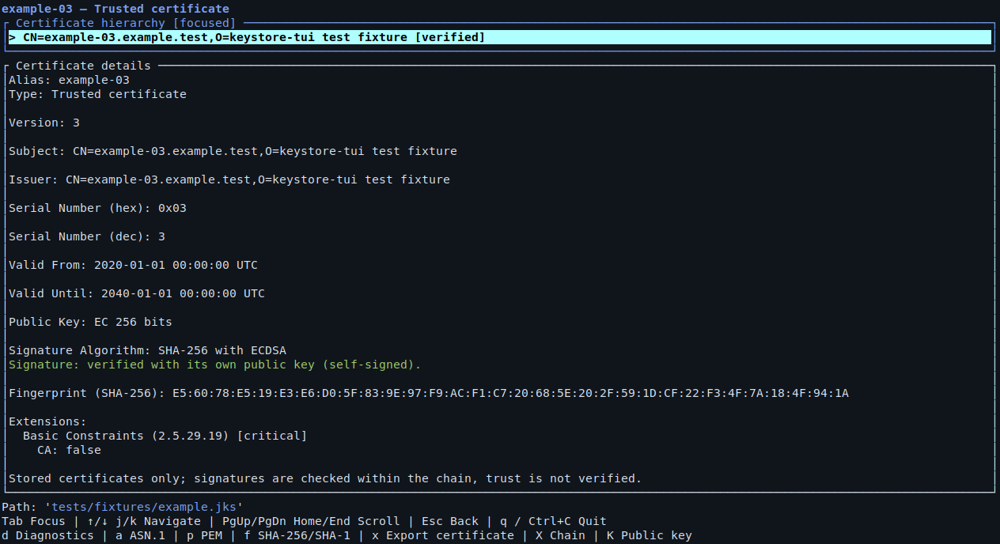

# keystore-tui

[](https://github.com/codecraft21/keystore-tui/actions/workflows/rust.yml?query=branch%3Amain)
[](https://codecov.io/gh/codecraft21/keystore-tui)
[](https://github.com/codecraft21/keystore-tui/releases/latest)
[](https://crates.io/crates/keystore-tui)
[](LICENSE)

A terminal app for managing keystores, keys, and certificates.

<p align="center">
  <a href="docs/main-screen.png"></a>
  <a href="docs/entry-details.png"></a>
  <a href="docs/chain-diagnostics.png"></a>
</p>

<p align="center"><sub>Entry list · Certificate details · Chain diagnostics — click an image for full size.</sub></p>

Open your keystore and see what’s inside. Inspect certificates, manage keys,
and make changes from your terminal—without Java or `keytool`.

- **Find what needs attention.** Browse and filter entries, spot expired
  certificates, and flag weak cryptography.
- **Understand your certificates.** Explore certificate details and chains,
  check signatures, and inspect certificate requests and revocation lists.
- **Manage keys and certificates.** Create keys, request and sign certificates,
  import and export entries, and update passwords.
- **Save with confidence.** Changes stay in memory until you save. Convert
  between keystore formats while keeping your keys and certificates together.

Supports JKS, JCEKS, and PKCS12 keystores, plus standalone certificates,
certificate requests, and revocation lists. See the
[usage reference](docs/REFERENCE.md) for supported formats and all available
actions.

## Install

With Homebrew (macOS and Linux):

```sh
brew install codecraft21/tap/keystore-tui
```

See [other installation methods](docs/INSTALL.md) for scripts, manual downloads,
building from source, and download verification.

## Usage

Apart from starting the app without parameters, you can open a keystore,
certificate, or certificate request directly:

```sh
keystore-tui "path/to/store.jks"
keystore-tui "path/to/certificate.pem"
```

Enter the keystore password when prompted. You can also run `keystore-tui`
without a path and press `o` to browse for a file.

Use the arrow keys to select an entry and `Enter` to inspect it. Press `Esc`
to return to the list, or `q` to quit. `keystore-tui --help` shows command-line
usage.

See the [usage reference](docs/REFERENCE.md) for all key bindings, filtering,
certificate details, chain diagnostics, ASN.1 and PEM views, and exports.

## Limitations

- Editing covers the [release 1.1 roadmap](docs/ROADMAP.md#release-11):
  creating, saving, and converting JKS, JCEKS, and PKCS12 keystores; deleting,
  renaming, importing, and copying entries; generating key pairs, certificate
  requests, and secret keys; signing certificates and revocation lists;
  importing CA replies and editing chains; exporting private, public, and
  secret keys; and changing passwords. The roadmap lists what is planned for
  release 1.2.
- PKCS12 keystores are saved with AES-256 and HMAC-SHA256, which Java 8 builds
  before 8u301 cannot read.
- Private and secret keys are never shown. They are decrypted only in
  memory, to sign, to export, or to protect them again.
- Clipboard actions are not available yet.
- PKCS12 integrity checks do not support PBMAC1 MACs.
- Files larger than 64 MiB are refused.

## More documentation

- [`docs/REFERENCE.md`](docs/REFERENCE.md): usage and key bindings.
- [`docs/SPEC.md`](docs/SPEC.md): the detailed behaviour specification.
- [`docs/ROADMAP.md`](docs/ROADMAP.md): planned features.
- [`AGENTS.md`](AGENTS.md): development checks, conventions, and shipping workflow.
- [`docs/ARCHITECTURE.md`](docs/ARCHITECTURE.md): module responsibilities and dependencies.
- [`docs/RELEASING.md`](docs/RELEASING.md): version bumps and release procedures.

## License

Apache-2.0. See [`LICENSE`](LICENSE).
