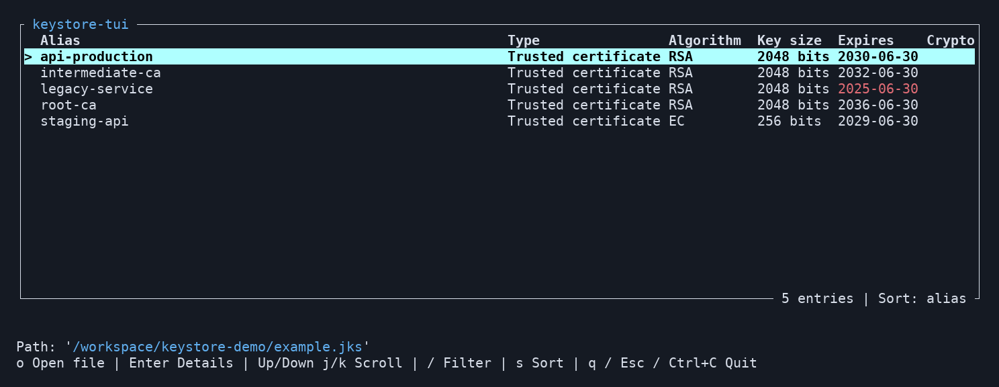
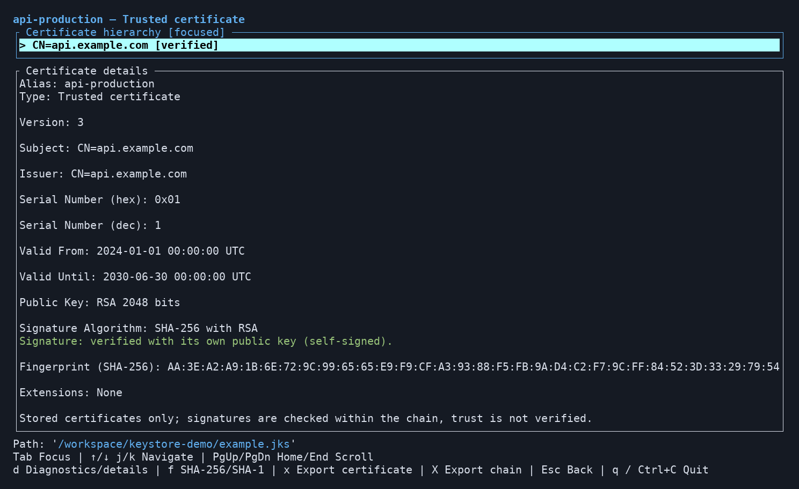
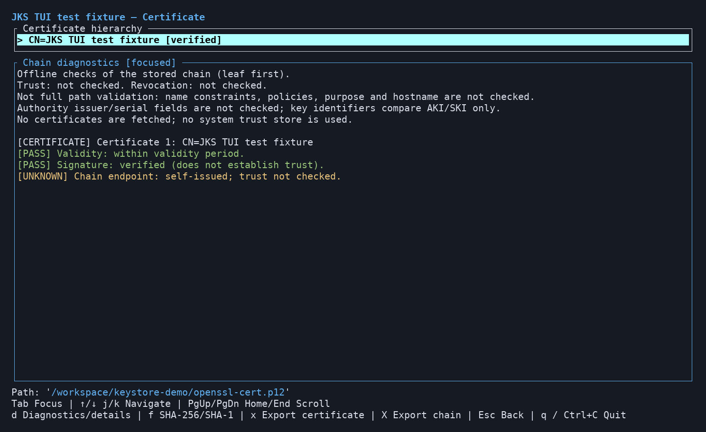

# keystore-tui

A terminal app for inspecting Java keystores.







Open a JKS, JCEKS, or PKCS12
(`.jks`, `.jceks`, `.p12`, `.pfx`) file, enter its password, and browse its
entries and certificates. It also
opens standalone certificate files (`.pem`, `.crt`, `.cer`, `.der`, `.p7b`,
`.p7c`) and certificate signing requests (`.csr`, `.p10`).

- Lists every entry with its type (private key, trusted certificate, or secret
  key), public key algorithm, key size, and expiry date. Certificates expiring
  within 30 days are shown in yellow and expired ones in red.
- Flags weak cryptography: RSA and DSA keys under 2048 bits, EC keys under 256
  bits, and MD2, MD5, or SHA-1 signatures.
- Filters entries by alias or subject, and sorts them by alias or expiry date.
- Shows each certificate's full details, including decoded extensions, and its
  certificate hierarchy, with each signature checked against the issuer's key.
- Diagnoses stored certificate chains offline: validity, issuer names and key
  identifiers, CA status, signing key usage, and path-length constraints.
- Shows a certificate signing request's subject, public key, requested
  extensions, and attributes, and checks its signature with its own key.
- Exports a certificate, a whole chain, or a request to a new PEM or DER file.
- Detects the format from the file content, so a PKCS12 store renamed `.jks`
  still opens.
- Opens PKCS12 files made by Java, OpenSSL, and other tools. Keys without a
  name are listed under their certificate's common name, and certificates that
  belong to no key are listed as `Certificate` entries.
- Read-only and self-contained: it never modifies existing files, never
  decrypts or displays private keys, and does not need Java or `keytool`.

## Install

Prebuilt binaries are published on the
[releases page](https://github.com/codecraft21/keystore-tui/releases) for
Linux (x86_64 and ARM64, statically linked), macOS (Intel and Apple Silicon),
and Windows (x86_64). Pick one of these ways to install:

- **Homebrew** (macOS and Linux):

  ```sh
  brew install codecraft21/tap/keystore-tui
  ```

- **Install script** (macOS and Linux), which downloads the binary for your
  platform into `~/.cargo/bin`:

  ```sh
  curl --proto '=https' --tlsv1.2 -LsSf https://github.com/codecraft21/keystore-tui/releases/latest/download/keystore-tui-installer.sh | sh
  ```

  On Windows, in PowerShell:

  ```powershell
  powershell -ExecutionPolicy Bypass -c "irm https://github.com/codecraft21/keystore-tui/releases/latest/download/keystore-tui-installer.ps1 | iex"
  ```

- **Manual download:** download the archive for your platform from the
  releases page, extract it, and put `keystore-tui` (or `keystore-tui.exe`) on
  your `PATH`. On macOS, a binary downloaded in a browser is quarantined
  because it is not notarized; run `xattr -d com.apple.quarantine keystore-tui`
  once to allow it.

- **From crates.io** with Rust 1.88 or later, which builds from source:

  ```sh
  cargo install --locked keystore-tui
  ```

- **From a clone** of the repository: `cargo run --locked`.

Check the installed version with `keystore-tui --version`.

### Verifying a download

Each archive has a `.sha256` checksum file next to it on the releases page.
Release artifacts also carry GitHub build provenance attestations, which the
[GitHub CLI](https://cli.github.com/) can check:

```sh
gh attestation verify keystore-tui-x86_64-unknown-linux-musl.tar.xz --repo codecraft21/keystore-tui
```

## Usage

Start with a keystore, certificate, or certificate request:

```sh
keystore-tui "path/to/store.jks"
keystore-tui "path/to/certificate.pem"
```

Enter the keystore password when prompted. You can also run `keystore-tui`
without a path and press `o` to browse for a file.

Use the arrow keys to select an entry and `Enter` to inspect it. Press `Esc`
to return to the list, or `q` to quit. `keystore-tui --help` shows command-line
usage.

See the [usage reference](docs/REFERENCE.md) for all key bindings, filtering,
certificate details, chain diagnostics, and exports.

## Limitations

- Keystores are read-only: there is no import or editing. Only certificates
  can be exported.
- Private keys are never decrypted, shown, or exported.
- Raw ASN.1 views and clipboard actions are not available yet.
- PKCS12 stores without an integrity MAC are supported. Encrypted contents still
  require a password. When present, the MAC is verified; PBMAC1 MACs are not supported.
- Files larger than 64 MiB are refused.

## More documentation

- [`docs/REFERENCE.md`](docs/REFERENCE.md): usage and key bindings.
- [`docs/SPEC.md`](docs/SPEC.md): the detailed behaviour specification.
- [`AGENTS.md`](AGENTS.md): architecture, development checks, and contribution
  guidelines.

## License

Apache-2.0. See [`LICENSE`](LICENSE).
