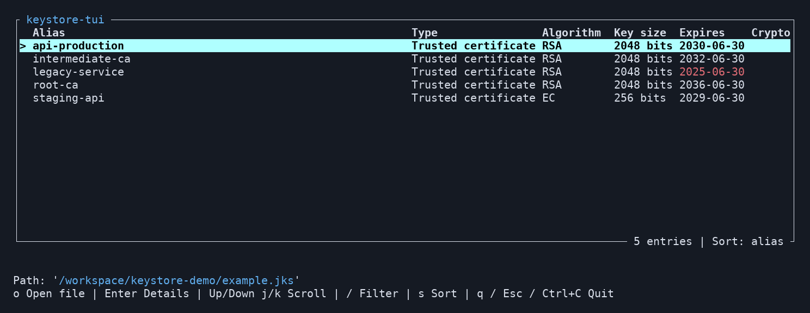
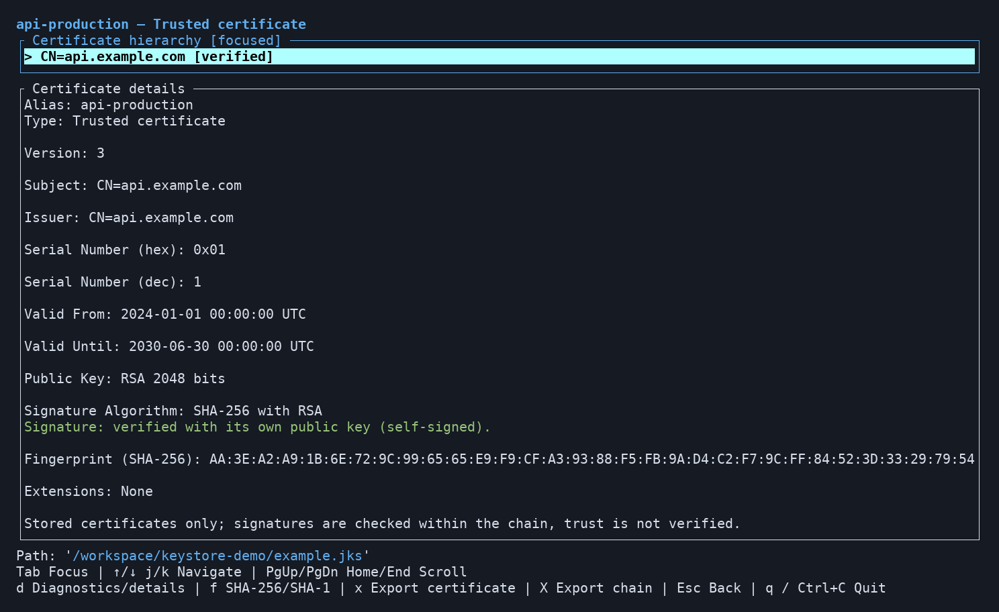
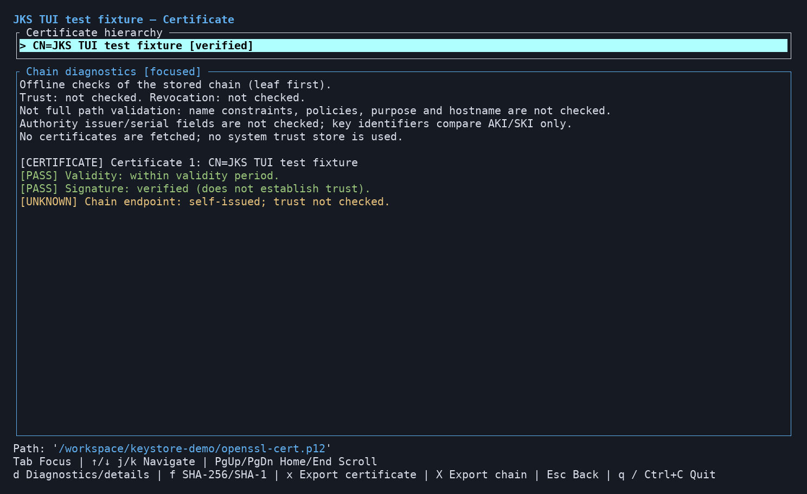

# keystore-tui

[](https://github.com/codecraft21/keystore-tui/actions/workflows/rust.yml?query=branch%3Amain)
[](https://codecov.io/gh/codecraft21/keystore-tui)
[](https://github.com/codecraft21/keystore-tui/releases/latest)
[](https://crates.io/crates/keystore-tui)
[](LICENSE)

A terminal app for inspecting keystores, certificates, and certificate signing requests.







Open a JKS, JCEKS, or PKCS12
(`.jks`, `.jceks`, `.p12`, `.pfx`) file, enter its password, and browse its
entries and certificates. It also
opens standalone certificate files (`.pem`, `.crt`, `.cer`, `.der`, `.p7b`,
`.p7c`) and certificate signing requests (`.csr`, `.p10`).

- Lists every entry with its type (private key, trusted certificate, or secret
  key), public key algorithm, key size, and expiry date. Certificates expiring
  within 30 days are shown in yellow and expired ones in red.
- Flags weak cryptography: RSA and DSA keys under 2048 bits, EC keys under 256
  bits, and MD2, MD5, or SHA-1 signatures.
- Filters entries by alias or subject, and sorts them by alias or expiry date.
- Shows each certificate's full details, including decoded extensions, and its
  certificate hierarchy, with each signature checked against the issuer's key.
- Diagnoses stored certificate chains offline: validity, issuer names and key
  identifiers, CA status, signing key usage, and path-length constraints.
- Shows a certificate signing request's subject, public key, requested
  extensions, and attributes, and checks its signature with its own key.
- Shows the raw ASN.1 structure and PEM encoding of a certificate or request.
- Exports a certificate, a whole chain, or a request to a new PEM or DER file.
- Detects the format from the file content, so a PKCS12 store renamed `.jks`
  still opens.
- Opens PKCS12 files made by Java, OpenSSL, and other tools. Keys without a
  name are listed under their certificate's common name, and certificates that
  belong to no key are listed as `Certificate` entries.
- Edits JKS and JCEKS keystores: import a trusted certificate, rename an
  entry, or delete one. Nothing changes on disk until you save, and saving
  replaces the file in one step.
- Safe and self-contained: it never decrypts or displays private keys, and
  does not need Java or `keytool`.

## Install

With Homebrew (macOS and Linux):

```sh
brew install codecraft21/tap/keystore-tui
```

See [other installation methods](docs/INSTALL.md) for scripts, manual downloads,
building from source, and download verification.

## Usage

Start with a keystore, certificate, or certificate request:

```sh
keystore-tui "path/to/store.jks"
keystore-tui "path/to/certificate.pem"
```

Enter the keystore password when prompted. You can also run `keystore-tui`
without a path and press `o` to browse for a file.

Use the arrow keys to select an entry and `Enter` to inspect it. Press `Esc`
to return to the list, or `q` to quit. `keystore-tui --help` shows command-line
usage.

See the [usage reference](docs/REFERENCE.md) for all key bindings, filtering,
certificate details, chain diagnostics, ASN.1 and PEM views, and exports.

## Limitations

- Editing is limited to JKS and JCEKS keystores: importing a trusted
  certificate, and renaming or deleting an entry. PKCS12 keystores cannot be
  changed yet, and key pairs cannot be imported. Only certificates,
  certificate chains, and certificate signing requests can be exported. More
  editing is planned for release 1.1; see the [roadmap](docs/ROADMAP.md).
- Private keys are not decrypted, shown, or exported yet.
- Clipboard actions are not available yet.
- PKCS12 integrity checks do not support PBMAC1 MACs.
- Files larger than 64 MiB are refused.

## More documentation

- [`docs/REFERENCE.md`](docs/REFERENCE.md): usage and key bindings.
- [`docs/SPEC.md`](docs/SPEC.md): the detailed behaviour specification.
- [`docs/ROADMAP.md`](docs/ROADMAP.md): planned features.
- [`AGENTS.md`](AGENTS.md): development checks, conventions, and shipping workflow.
- [`docs/ARCHITECTURE.md`](docs/ARCHITECTURE.md): module responsibilities and dependencies.
- [`docs/RELEASING.md`](docs/RELEASING.md): version bumps and release procedures.

## License

Apache-2.0. See [`LICENSE`](LICENSE).
