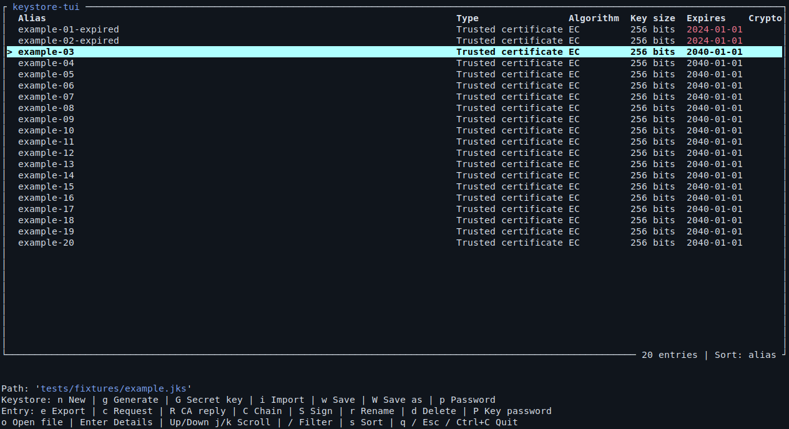
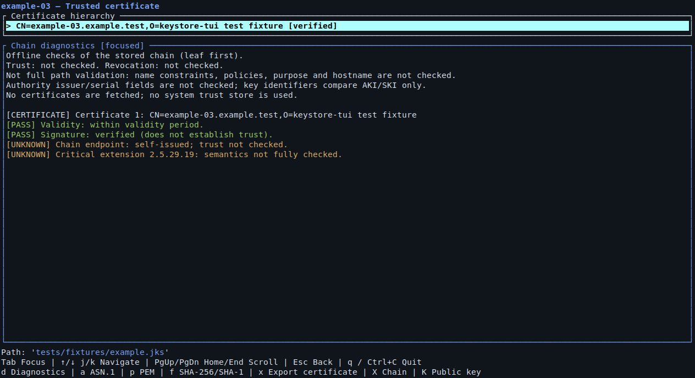

# keystore-tui

[](https://github.com/codecraft21/keystore-tui/actions/workflows/rust.yml?query=branch%3Amain)
[](https://codecov.io/gh/codecraft21/keystore-tui)
[](https://github.com/codecraft21/keystore-tui/releases/latest)
[](https://crates.io/crates/keystore-tui)
[](LICENSE)

A terminal app for managing keystores, keys, and certificates.

<p align="center">
  <a href="docs/main-screen.png"></a>
  <a href="docs/entry-details.png"></a>
  <a href="docs/chain-diagnostics.png"></a>
</p>

<p align="center"><sub>Entry list · Certificate details · Chain diagnostics — click an image for full size.</sub></p>

Open your keystore and see what’s inside. Inspect certificates, manage keys,
and make changes from your terminal—without Java or `keytool`.

- **Find what needs attention.** Browse and filter entries, spot expired
  certificates, and flag weak cryptography.
- **Understand your certificates.** Explore certificate details and chains,
  check signatures, and inspect certificate requests and revocation lists.
- **Manage keys and certificates.** Create keys, request and sign certificates,
  import and export entries, and update passwords.
- **Save with confidence.** Changes stay in memory until you save. Convert
  between keystore formats while keeping your keys and certificates together.

Supports JKS, JCEKS, and PKCS12 keystores, plus standalone certificates,
certificate requests, and revocation lists. See the
[usage reference](docs/REFERENCE.md) for supported formats and all available
actions.

## Install

With Homebrew (macOS and Linux):

```sh
brew install codecraft21/tap/keystore-tui
```

See [other installation methods](docs/INSTALL.md) for scripts, manual downloads,
building from source, and download verification.

## Usage

Start the app without parameters:

```sh
keystore-tui
```

From there, open an existing file or create a new keystore.

You can also open a keystore directly by passing its path:

```sh
keystore-tui "path/to/store.jks"
```

See the [usage reference](docs/REFERENCE.md) for the complete guide.

## Limitations

- Certificate checks run offline. They don’t establish whether a certificate
  is trusted or has been revoked.
- Saved PKCS12 files may not work with older Java versions.
- Some PKCS12 protection formats, including PBMAC1, aren’t supported.
- Built-in clipboard actions aren’t available.
- Files larger than 64 MiB can’t be opened.

See the [roadmap](docs/ROADMAP.md) for planned features.

## License

Apache-2.0. See [`LICENSE`](LICENSE).
